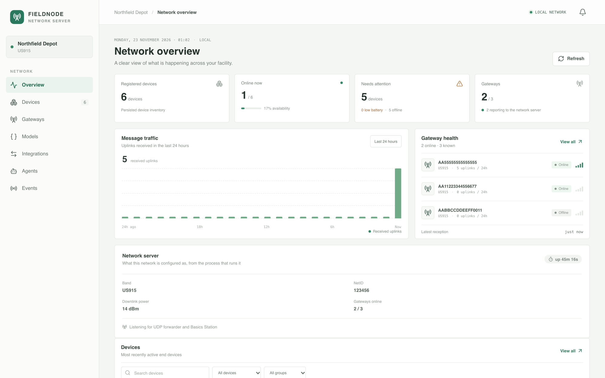
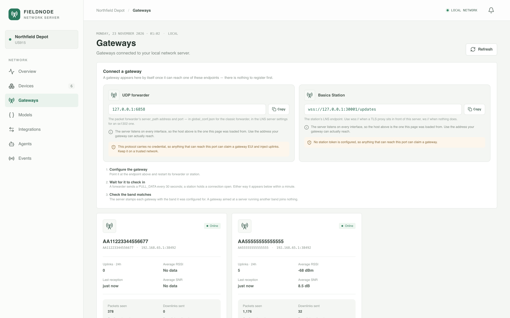

# Fieldnode

**A LoRaWAN network server and operations console you can run yourself.**

Point a gateway at it, register a device, and read what the sensor said. There is
no gateway bridge, no MQTT broker and no Redis: the network server speaks the
Semtech UDP protocol and LoRa Basics Station directly, and everything it knows
lives in a single PostgreSQL database beside it.



It is intended for a private deployment of tens to a few thousand devices, where
the operator needs to explain why a device stopped reporting without routing the
telemetry through a third-party cloud to find out.

## Contents

- [Quick start](#quick-start)
- [Verify without radio hardware](#verify-without-radio-hardware)
- [Connect a gateway](#connect-a-gateway)
- [Add a device](#add-a-device)
- [Turn bytes into readings](#turn-bytes-into-readings)
- [Read the event log](#read-the-event-log)
- [Agent integration (MCP)](#agent-integration-mcp)
- [Operational considerations](#operational-considerations)
- [Contributing](#contributing)
- [Status](#status)

## Quick start

Requirements: Docker with Compose v2, roughly a gigabyte of free memory, and TCP
8082, TCP 30001 and UDP 6858 free on the host.

```sh
cp .env.example .env
```

Open `.env` and set three values:

| Variable | What it is |
| --- | --- |
| `POSTGRES_PASSWORD` | The database password. Set it before the first start — see [the password trap](#the-password-trap). |
| `NETWORK_NET_ID` | Exactly six hex digits, e.g. `123456`. An OTAA device must be configured with this NetID or it will reject this network's join-accept. |
| `NS_API_TOKEN` | The bearer token for the provisioning and downlink API. |

`openssl rand -hex 24` produces a suitable value for the password and the token. The
NetID is neither a secret nor random: it must match the value programmed into the
devices, so choose one and record it.

Then:

```sh
docker compose up --build -d
```

and open **http://127.0.0.1:8082**.

Compose refuses to start when a required variable is unset rather than
substituting a development default, so a stack that started has real credentials
in it. The first start takes a few minutes while the images build; later starts are
fast.

The console has no login of its own, which is why it binds to loopback. For LAN or
WAN access, put it behind an authenticated TLS reverse proxy; do not publish the
port directly. The gateway UDP port is the one listener that must be reachable from
the network — restrict it to the gateway subnet at the firewall.

### What runs

| Service | What it does | Reachable at |
| --- | --- | --- |
| `ns` | The network server. Protocol, sessions, MAC, ADR, duty cycle, provisioning API. | UDP 6858 and TCP 30001 for gateways; 8090 and 8091 on loopback |
| `api` | The console's read API and provisioning proxy. | internal only |
| `web` | The React console, behind nginx, which proxies `/api` to `api`. | http://127.0.0.1:8082 |
| `db` | PostgreSQL. Each service owns its own tables through its own migration runner. | internal only |
| `mcp` | Optional MCP server for agents. Off unless you start the profile. | 8092 on loopback |

The database and the API are on an internal Docker network with no published
ports, so nothing outside the host can reach them.

## Verify without radio hardware

No gateway or sensor is required to exercise the software. `nsbench` is a simulated
gateway and a simulated class-A device that talk to a running server over a real UDP
socket: it joins over the air, sends a confirmed uplink, receives the acknowledgement,
and reports the result.

```sh
cd ns && make smoke
```

That runs the real network server binary and the real `nsbench` against each other,
and also checks the health endpoint and clean shutdown. To drive a stack that is
already running, provision the device `nsbench` uses by default and run it; both
commands work as written:

```sh
curl -X POST http://127.0.0.1:8091/api/v1/devices \
  -H "Authorization: Bearer $NS_API_TOKEN" -H 'Content-Type: application/json' \
  -d '{"dev_eui":"0011223344556677","join_eui":"0102030405060708","app_key":"2B7E151628AED2A6ABF7158809CF4F3C","name":"Simulated device"}'

cd ns && go run ./cmd/nsbench -net-id 123456
```

The simulator announces a gateway with EUI `AA55555555555555`, so it appears in the
console alongside any real gateways. `-gateway-eui`, `-dev-eui`, `-join-eui` and
`-app-key` override the defaults.

Within seconds the console shows the gateway online, the device joined, and the
frame in the event log.

This is also the check to run after a real installation. A device registered through
the console should appear as `Offline` / `Not joined` until it transmits; the
simulator exercises the whole path — socket, protocol, session, MAC, storage,
console — without a radio. If devices appear but no traffic does, the gateway is not
reaching UDP 6858. `http://127.0.0.1:8090/status` lists every forwarder the server
has heard from, which establishes whether the packets are arriving at all.

## Connect a gateway

No registration is required. Point the packet forwarder at this host's UDP port
**6858** (`server_port` in `global_conf.json`) and it appears in the console within
about thirty seconds: a forwarder that sends `PULL_DATA` is taken as present, and the
address it sent from is where downlinks are sent. LoRa Basics Station gateways —
MultiTech, Kerlink, or anything that speaks LNS — connect to
`ws://this-host:30001/updates` instead; the **Gateways** page shows both endpoints.



The same page reports what a gateway is actually doing: uplinks in the last day,
average RSSI and SNR, packets seen, downlinks sent, and the transmission errors the
concentrator reported (`TOO_LATE`, `TX_COL`, `NO_GPS`). A gateway counts as online
because it recently sent `PULL_DATA`. That is presence, not health — a forwarder with
a broken RF chain still sends `PULL_DATA` — which is why the radio counters are shown
alongside the status indicator rather than behind it.

The band matters. The server records each gateway against the band it is configured
for, and a gateway aimed at a server running a different band joins nothing.
`NS_REGION` in `.env` must match the forwarder's `global_conf.json`.

## Add a device

Use **Devices → Add device** and enter the DevEUI and AppKey from the device label.
The console passes them to the network server's provisioning API, which validates
and stores the credentials. A device can join as soon as it appears in the list.


Keys go in and never come out. No endpoint returns an AppKey, a session key or a
device's credentials, and the console never asks for them back. That is the correct
behaviour for a dashboard that may be open on a shared screen, and it is why there
is no "copy key" control.

Opening a device shows the network's current view of it: the session and frame
counters, data rate and TX power, whether ADR is active, the last RSSI and SNR, when it
last reported, battery and link margin if it has answered a DevStatusReq, and any
downlink waiting for its next window.


Two values are easy to misread. A battery of **255** means the device cannot report a
level, not that it is full. A device shown as **Offline** has simply not transmitted
recently, which for an hourly sensor is expected rather than a fault.

To provision from a script or another system, call the API directly. It also accepts
ABP, per-device radio limits, groups, operator attributes and a position:

```sh
curl -X POST http://127.0.0.1:8091/api/v1/devices \
  -H "Authorization: Bearer $NS_API_TOKEN" -H 'Content-Type: application/json' \
  -d '{"dev_eui":"AABBCCDDEEFF0011","app_key":"2B7E151628AED2A6ABF7158809CF4F3C","name":"Boiler sensor","group":"Plant room"}'
```

`join_eui` is optional and behaves as a wildcard when omitted: it is stored as all
zeros, which the join path accepts against any JoinEUI. Set it to have the network
refuse joins presented on a different JoinEUI. Creating over an existing DevEUI is
rejected rather than applied, because an upsert would let a mistyped DevEUI silently
overwrite a live device's keys; `PUT` is the method that means replace.

## Turn bytes into readings

A device model describes a kind of sensor and carries the payload formatter — the
JavaScript a vendor publishes in its datasheet — that converts the device's bytes
into readings. Models are stored in the network server's database and managed under
**Models** in the console.


The workflow is: paste the vendor's script, paste a sample frame from the same
datasheet, press **Test decode**, and save only once the output is correct. The test
runs the script in the editor rather than the stored one, so a change can be verified
before it reaches a fleet, and a script that does not compile is rejected at save time
with the parser's message.

Then assign the model: **Devices → a device → Settings → Device model**. The device's
readings appear in its console panel. Changing or deleting a model affects new uplinks
only — stored readings retain whatever decoded them, so history is not rewritten when
a formatter is corrected.

Devices with no model still function: they join, they report, and their frames are
stored and displayed as hex. A model determines how bytes are interpreted, not whether
the network accepts them.

A formatter that stops working is otherwise invisible — devices appear healthy while
every frame from them is stored undecoded — so the **Models** page also reports what
the server actually decoded, and names the models whose script failed to compile
together with the compiler's message.

## Read the event log

The **Events** page is the network's own log, newest first. It turns "this device is
offline" into "this device's last frame was refused because its frame counter
jumped" — the first is an observation, the second is actionable.


Every join, uplink, downlink and MAC exchange is recorded, along with every frame
the network refused and the reason it refused. Refusals are the reason the page
exists: a dropped frame is otherwise invisible, because the device simply stops
appearing in the readings and looks idle rather than broken.

Reasons are precise, and several describe the network operating correctly rather than
failing:

| Reason | Meaning |
| --- | --- |
| `duplicate_frame` | Two gateways received the same frame and one was discarded. Expected behaviour. |
| `duty_cycle_denied` | The band's legal airtime budget had no capacity remaining. A regulatory refusal, not a fault; the detail states when capacity is available again. |
| `adr_keepalive` | A LinkADRReq that deliberately changes nothing, preventing the device from falling back to a slower data rate. |
| `f_cnt_gap_too_large` | Frames were lost, or the device restarted its counter while the network retained the session. |
| `uplink_mic_failed` | The device and the network hold different session keys — usually a join-accept the device never received. |
| `no_rx_window_available` | No gateway could respond. Typically a forwarder that has never sent `PULL_DATA`, leaving no address to reply to. |

The full vocabulary lives in
[`ns/internal/engine/events.go`](ns/internal/engine/events.go), once, with what each
value means. It is the first file to read when the question is why a frame did not
get through.

The same history is available over the API, which is what makes it scriptable and
what the agent integration below reads:

```sh
# The last fifty things the network recorded.
curl -H "Authorization: Bearer $NS_API_TOKEN" http://127.0.0.1:8091/api/v1/events

# One device's history, only the refusals.
curl -H "Authorization: Bearer $NS_API_TOKEN" \
  "http://127.0.0.1:8091/api/v1/events?dev_eui=0011223344556677&kind=uplink_drop"
```

## Agent integration (MCP)

An optional service speaks the Model Context Protocol, so an agent can answer
questions about the network from live state rather than from inference. It is
disabled unless started, because it adds an authenticated listener that can act on
the network.

Set `MCP_AUTH_TOKEN` in `.env` first (`openssl rand -hex 24`). It must be a
different secret from `NS_API_TOKEN`: a single value guarding both this listener and
the network server's API means one leak compromises both, and the process refuses to
start when the two are equal. Then:

```sh
docker compose --profile mcp up -d
```

The console has an **Agents** page covering it: whether a listener is responding, two
ready-to-use client configurations, every tool with a read/write indicator, and the
limitations worth reading before connecting an agent to a live network.


It never displays a token: the configs carry placeholders, because a console holding
the listener's secret would undo the separation between it and the network server's
API.

By default an agent can only read, which is the appropriate setting for almost every
deployment. `MCP_PROFILE=operate` adds queueing a downlink, cancelling one, requesting
a battery report and changing a device's configuration. Creating a device, changing an
event destination and installing a payload formatter are absent from every profile;
[`mcp/README.md`](mcp/README.md) explains why those are excluded rather than merely
gated.

## Operational considerations

Running this yourself carries obligations that a feature list does not show.

**Devices set the pace, not the operator.** This is a class-A network: a device can be
reached only in the two short windows after it transmits, and is silent until its next
scheduled report. There is no immediate downlink. A queued frame waits in the device's
single pending slot until it next wakes, which for an hourly sensor can be hours, and
an absence of recent traffic is usually normal rather than a fault. Class B and class
C are not implemented.

**The band has to match on both sides.** `NS_REGION` in `.env` and the forwarder's
`global_conf.json` must name the same band. A gateway aimed at a server running a
different band joins nothing, and the symptom is silence rather than an error. UDP
packet forwarders have no configuration channel: the server cannot correct a gateway
that was configured incorrectly. Basics Station is the only transport here where
configuration can be pushed.

**Duty cycle is a legal limit, not a preference.** The server enforces the band's
sub-band airtime budget and refuses transmissions that would exceed it, counting each
denial. The refusal is correct behaviour, and it will occasionally delay a downlink.
The ledger survives a restart, so a restarted server cannot spend allowance it has
already used.

**The console has no login of its own.** It binds to loopback for that reason. On a
LAN or WAN, put it behind an authenticated TLS reverse proxy rather than publishing
the port. UDP 6858 is the one listener that must be reachable from the network;
restrict it to the gateway subnet at the firewall.

**The database holds what cannot be rebuilt.** Device keys, join nonces and frame
counter state live in the `postgres-data` volume. Losing it does not mean re-entering
a few settings: every OTAA device on the network has to be de-provisioned and joined
again. Back that volume up. `docker compose down` stops the stack and keeps the
volume; `-v` deletes it.

### The password trap

**Changing `POSTGRES_PASSWORD` later does not change the database's password.**
PostgreSQL applies it only when the volume is first initialised, so editing it in
`.env` afterwards leaves every service unable to connect. Either change it in both
places:

```sh
docker compose exec db psql -U fieldnode -d fieldnode -c \
  "ALTER ROLE fieldnode WITH PASSWORD 'new password'"
```

or accept the data loss and start over with `docker compose down -v`.

## Contributing

### Tests

```sh
cd ns && make test      # network server: codec, region, engine, transport, API
cd api && go test ./... # console API
npm install && npm run lint && npm run build
npm run smoke           # renders the console's components and asserts on their output
```

`ns/Makefile` runs the Go toolchain in Docker, so no local Go installation is needed.
`make test-pg` runs the storage tests against a real PostgreSQL; `NS_TEST_DSN` points
them at a database.

A successful build and test run does not cover everything, because prose is not
compiled. After any move or rename:

```sh
./check-stale-refs.sh   # comments, docs and SQL that point at paths which no
                        # longer exist; exits non-zero when one is stale
```

It is deliberately narrow. HTTP routes, Go import paths and citations into ChirpStack's
Rust tree are excluded by construction, on the principle that a check producing false
positives is a check that gets ignored.

### Layout

```
ns/            network server — protocol codec, regions, engine, gateway
               transport, integrations, provisioning API (see ns/README.md)
api/           console API: reads ns_* tables, provisions through the ns API
mcp/           optional MCP server for agents — its own module and go.mod
src/           React console
db/            database bootstrap (schema is owned by the services' migrations)
docs/          screenshots used by this README
```

### Licensing

MIT — see [LICENSE](LICENSE).

```
Copyright (c) 2026 Ammar Bandukwala
```

Use it, modify it, distribute it, incorporate it into commercial products. The one
condition is the standard one: the copyright notice and the permission notice remain
attached to any copy or substantial portion of the source. Attribution in your own
documentation is welcome, but MIT requires nothing beyond that notice.

### Credits

Protocol behaviour follows the LoRaWAN 1.0.3 and RP002 1.0.3 specifications, RFC
4493 and the LoRaWAN ADR application note; those are read as documents, not
vendored, and the normative source for regional parameters is RP002.

A small number of test vectors and one algorithm's parameterisation were derived
from an MIT-licensed LoRaWAN implementation. That license is compatible with this
one, and because MIT requires the notice to accompany those portions,
[`THIRD_PARTY_NOTICES.md`](THIRD_PARTY_NOTICES.md) names exactly what was taken,
where it landed, and reproduces the upstream notice.

## Status

**Implemented and covered by tests**

- OTAA and ABP activation, session and frame-counter management
- Adaptive data rate, confirmed uplinks and their acknowledgements
- Multi-gateway reception with de-duplication
- Duty-cycle and time-on-air enforcement, with a ledger that survives a restart
- Semtech UDP and LoRa Basics Station gateway transports
- MQTT and webhook integrations; JavaScript payload formatters
- Regions: US915, EU868, AS923 including the -2, -3 and -4 offsets

**Not implemented**

| Item | Consequence |
| --- | --- |
| Class B and class C | Devices are reachable only in the two RX windows following their own transmission. There is no immediate downlink. |
| LoRaWAN 1.1, roaming, FUOTA | This server implements LoRaWAN 1.0.3. |
| Multi-gateway downlink transmission | A downlink is sent through the single gateway with the best signal-to-noise, not through every gateway that heard the device. |
| RX-window detection | Packet forwarders do not report which window a frame arrived in, so every uplink is treated as RX1. |
| Cross-process airtime reservation | Duty-cycle bookings are written on a timer, so two `ns` instances can each reserve the same slot. Run a single instance. |
| Station reconfiguration | `router_config` is sent at handshake only; a station must reconnect to learn a changed band or RX2 setting. The concentrator plan (`sx1301_conf`) is not pushed unless `NS_LBS_RADIO_PLAN` names a file. |
| `NewChannelReq` on US915 | Refused. The RX1-to-downlink-channel mapping is derived from the channel index, so an arbitrary user channel needs downlink-side work that is not present. |
| `ADRParamSetupReq` (CID 0x0C) | `ADRACKLimit` and `ADRACKDelay` come from server configuration, not from the device profile. |

[`ns/README.md`](ns/README.md) holds the full list with the reasoning behind each
item, together with the milestone roadmap.
