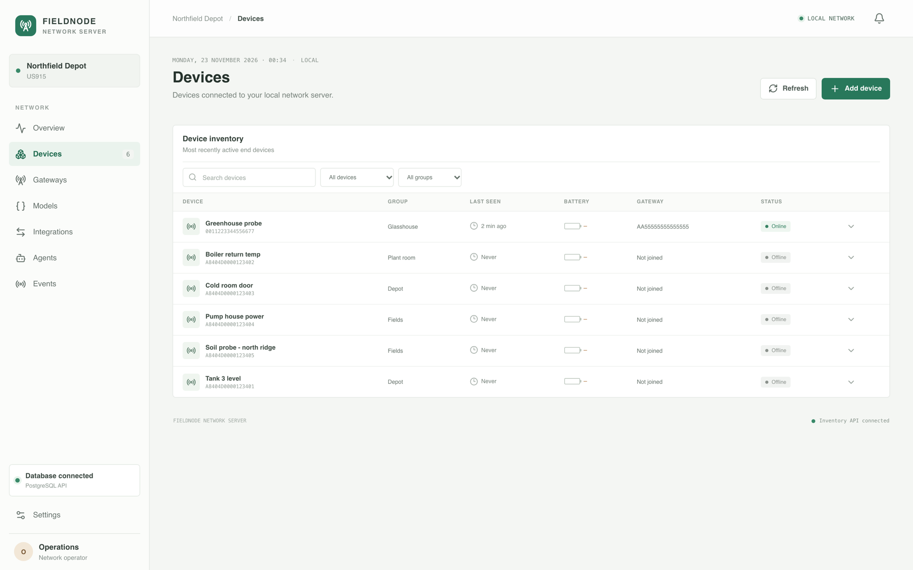
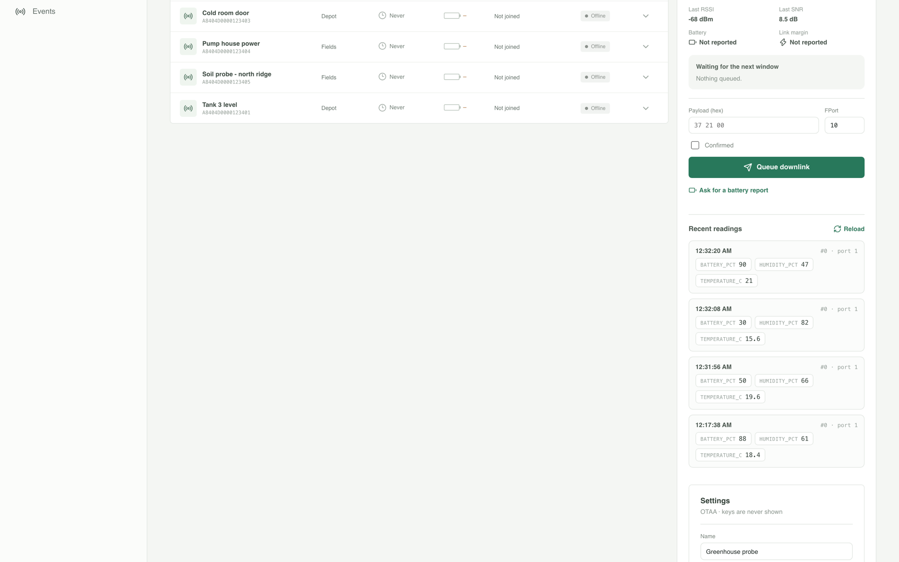
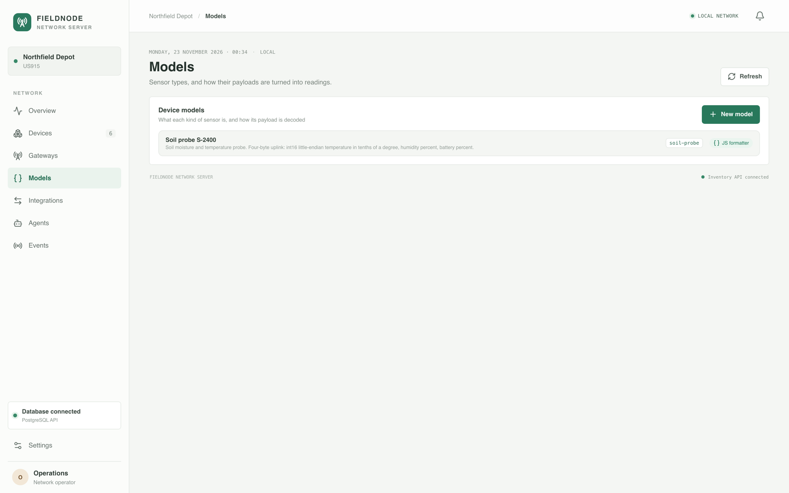
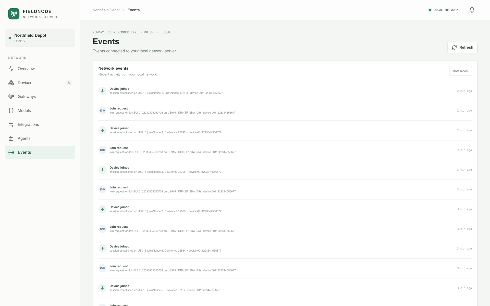
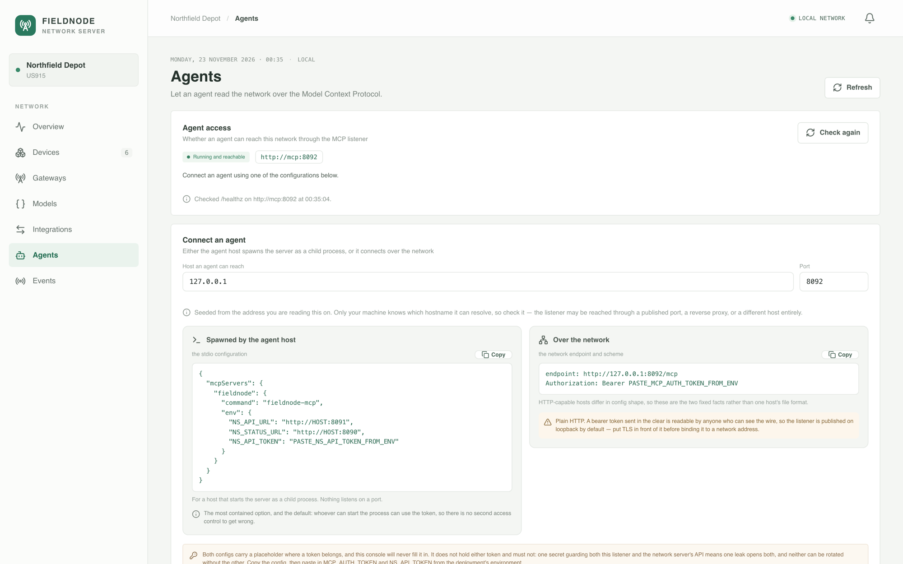

# Fieldnode

**A LoRaWAN network server and operations console you can run yourself.**

Point a gateway at it, register a device, and read what the sensor said. No
gateway bridge, no MQTT broker, no Redis — the network server speaks the Semtech
UDP protocol and LoRa Basics Station directly, and everything it knows lives in
one PostgreSQL database beside it.


It is built for the person running a few hundred sensors on their own hardware,
who wants to know why tank 3 has not reported today without shipping their
telemetry to somebody else's cloud to find out.

## Contents

- [Try it in five minutes](#try-it-in-five-minutes)
- [See it work with no radio hardware](#see-it-work-with-no-radio-hardware)
- [Connect a gateway](#connect-a-gateway)
- [Put a device on the network](#put-a-device-on-the-network)
- [Turn bytes into readings](#turn-bytes-into-readings)
- [Ask the network what happened](#ask-the-network-what-happened)
- [Let an agent answer questions](#let-an-agent-answer-questions)
- [What you are taking on](#what-you-are-taking-on)
- [Contributing](#contributing)

## Try it in five minutes

You need Docker with Compose v2, about a gigabyte of free memory, and TCP 8082,
TCP 30001 and UDP 6858 free on the host.

```sh
cp .env.example .env
```

Open `.env` and set three values:

| Variable | What it is |
| --- | --- |
| `POSTGRES_PASSWORD` | The database password. Set it before the first start — see [the password trap](#the-password-trap). |
| `NETWORK_NET_ID` | Exactly six hex digits, e.g. `123456`. An OTAA device must be configured with this NetID or it will reject this network's join-accept. |
| `NS_API_TOKEN` | The bearer token for the provisioning and downlink API. |

`openssl rand -hex 24` makes a good value for the password and the token. The NetID
is not a secret and is not random — it has to match what the devices are configured
with, so pick one and write it down.

Then:

```sh
docker compose up --build -d
```

and open **http://127.0.0.1:8082**.

Compose refuses to start when a required variable is missing rather than
substituting a development password, so a stack that came up has real secrets in
it. The first start takes a few minutes while the images build; later starts are
fast.

The console has no login of its own, which is why it binds to loopback. For LAN
or WAN access put it behind an authenticated TLS reverse proxy — do not publish
the port directly. The gateway UDP port is the one listener that has to be
reachable from the network; restrict it to the gateway subnet at the firewall.

### What runs

| Service | What it does | Reachable at |
| --- | --- | --- |
| `ns` | The network server. Protocol, sessions, MAC, ADR, duty cycle, provisioning API. | UDP 6858 and TCP 30001 for gateways; 8090 and 8091 on loopback |
| `api` | The console's read API and provisioning proxy. | internal only |
| `web` | The React console, behind nginx, which proxies `/api` to `api`. | http://127.0.0.1:8082 |
| `db` | PostgreSQL. Each service owns its own tables through its own migration runner. | internal only |
| `mcp` | Optional MCP server for agents. Off unless you start the profile. | 8092 on loopback |

The database and the API are on an internal Docker network with no published
ports, so nothing outside the host can reach them.

## See it work with no radio hardware

You do not need a gateway or a sensor to see what this does. `nsbench` is a
simulated gateway and a simulated class-A device that talk to a running server
over a real UDP socket: it joins over the air, sends a confirmed uplink, receives
the acknowledgement, and reports what came back.

```sh
cd ns && make smoke
```

That runs the real network server binary and the real `nsbench` against each
other and checks the health endpoint and clean shutdown too. To drive the stack you
have already started instead, provision the device `nsbench` uses by default and then
run it — both commands are copy-pasteable as they stand:

```sh
curl -X POST http://127.0.0.1:8091/api/v1/devices \
  -H "Authorization: Bearer $NS_API_TOKEN" -H 'Content-Type: application/json' \
  -d '{"dev_eui":"0011223344556677","join_eui":"0102030405060708","app_key":"2B7E151628AED2A6ABF7158809CF4F3C","name":"Simulated device"}'

cd ns && go run ./cmd/nsbench -net-id 123456
```

The simulator announces a gateway with EUI `AA55555555555555`, so it appears in the
console as an unfamiliar gateway beside your real ones; `-gateway-eui`, `-dev-eui`,
`-join-eui` and `-app-key` change them if you would rather it did not.

Within seconds the console shows the gateway online, the device joined, and the
frame in the event log.

That is also the check to run after a real install. A device registered through the
console should appear as `Offline` / `Not joined` until it speaks; running the
simulator proves the whole path — socket, protocol, session, MAC, storage, console —
without a radio. If devices appear but no traffic does, the gateway is not reaching
UDP 6858: `http://127.0.0.1:8090/status` lists every forwarder the server has heard
from, which tells you whether the packet is arriving at all.

## Connect a gateway

There is nothing to register. Point the packet forwarder at this host's UDP port
**6858** (`server_port` in `global_conf.json`) and it appears in the console
within about thirty seconds: a forwarder that sends `PULL_DATA` is taken as
present, and the address it sent from is where downlinks go. LoRa Basics Station
gateways — MultiTech, Kerlink, anything that speaks LNS — connect to
`ws://this-host:30001/updates` instead, and the **Gateways** page gives you both
endpoints ready to copy.


The same page is where you check what a gateway is actually doing: uplinks in the
last day, average RSSI and SNR, packets seen, downlinks sent, and the transmission
errors the concentrator reported (`TOO_LATE`, `TX_COL`, `NO_GPS`). A gateway counts
as online because it recently sent `PULL_DATA`. That is presence, not health — a
forwarder with a broken RF chain still sends `PULL_DATA` — which is why the radio
numbers sit next to the dot rather than behind it.

The band matters. The server stamps each gateway with the band it is configured
for, and a gateway aimed at a server running a different band joins nothing.
`NS_REGION` in `.env` has to match what the forwarder's `global_conf.json` says.

## Put a device on the network

Use **Devices → Add device** and enter the DevEUI and AppKey printed on the device
label. The console passes that to the network server's provisioning API, which
validates the credentials and stores them. A device can join as soon as it appears
in the list.



Keys go in and never come out. No endpoint returns an AppKey, a session key or a
device's credentials, and the console never asks for them back — which is the right
behaviour for a dashboard that might be open on a shared screen, and the reason
there is no "copy key" button to misplace.

Open a device to see what the network currently believes about it: the session and
frame counters, data rate and TX power, whether ADR is active, the last RSSI and
SNR, when it last reported, battery and link margin if it ever answered a
DevStatusReq, and any downlink waiting for its next window.



Two numbers worth knowing how to read: a battery of **255** means the device cannot
report a level, not that it is empty; and a device that is **Offline** has simply
not spoken recently, which for a sensor that reports hourly is normal rather than
a fault.

To provision from a script or another system, call the API directly. It also accepts
ABP, per-device radio limits, groups, operator attributes and a position:

```sh
curl -X POST http://127.0.0.1:8091/api/v1/devices \
  -H "Authorization: Bearer $NS_API_TOKEN" -H 'Content-Type: application/json' \
  -d '{"dev_eui":"AABBCCDDEEFF0011","app_key":"2B7E151628AED2A6ABF7158809CF4F3C","name":"Boiler sensor","group":"Plant room"}'
```

`join_eui` is optional here and worth understanding: left out it is stored as all
zeros, which the join path treats as *any* JoinEUI. Set it when you want the network
to refuse joins that arrive on someone else's JoinEUI. Creating over an existing
DevEUI is refused rather than applied, because an upsert means a typo'd DevEUI
silently rewrites a live device's keys — `PUT` is the verb that means replace.

## Turn bytes into readings

A device's bytes mean nothing until something reads them. A **device model** is
what says what a kind of sensor is, and it carries the payload formatter — the
JavaScript a vendor prints in its datasheet — that turns those bytes into
readings. Models live in the network server's database and are managed under
**Models** in the console.



The loop is: paste the vendor's script, paste a frame from the same datasheet,
press **Test decode**, and only then save. The test runs the script in the editor
rather than the stored one, so an edit can be proven before it reaches a fleet,
and a script that will not compile is refused at save time with the parser's own
message. Nothing is decoded by a formatter nobody has looked at.

Then point devices at it: **Devices → a device → Settings → Device model**. The
device's readings appear in its console panel. Changing or deleting a model
affects new uplinks only — stored readings keep whatever decoded them, so history
does not rewrite itself when a formatter is corrected.

Devices with no model still work: they join, they report, and their frames are
stored and shown as hex. A model decides how bytes are read, not whether the
network accepts them.

A formatter that stops working is otherwise invisible — the devices look healthy
while every frame from them is stored as unreadable bytes — so the **Models** page
also reports what the server actually managed to decode, and names the models
whose script it could not compile along with the compiler's message.

## Ask the network what happened

The **Events** page is the network's own log, newest first. It is the difference
between "tank 3 is offline" and "tank 3's last frame was refused because its frame
counter jumped" — the first is something you noticed, the second is something you
can act on.



Every join, uplink, downlink and MAC exchange is recorded, along with every frame
the network refused and the reason it refused. Refusals are the reason the page
exists: a dropped frame is otherwise invisible, because the device simply does not
appear in the readings and looks quiet rather than broken.

The reasons are precise, and a few of them describe the network working correctly
rather than failing:

| You see | It means |
| --- | --- |
| `duplicate_frame` | Two gateways heard the same frame and one was discarded. Working as designed. |
| `duty_cycle_denied` | The band's legal airtime budget had no room left. A regulatory refusal, not a fault — the detail says when budget frees up. |
| `adr_keepalive` | A LinkADRReq that changes nothing on purpose, so the device does not fall back to a slower data rate. |
| `f_cnt_gap_too_large` | Frames were lost, or the device restarted its counter while the network kept the session. |
| `uplink_mic_failed` | The device and the network disagree about the session key — usually a join-accept the device never received. |
| `no_rx_window_available` | No gateway could answer. Classically a forwarder that has never sent `PULL_DATA`, so there is no address to reply to. |

The full vocabulary lives in
[`ns/internal/engine/events.go`](ns/internal/engine/events.go), once, with what each
one means — it is the first file to open when the question is why a frame did not
get through.

The same history is an API, which is what makes it scriptable and what the agent
below reads:

```sh
# The last fifty things the network recorded.
curl -H "Authorization: Bearer $NS_API_TOKEN" http://127.0.0.1:8091/api/v1/events

# One device's history, only the refusals.
curl -H "Authorization: Bearer $NS_API_TOKEN" \
  "http://127.0.0.1:8091/api/v1/events?dev_eui=0011223344556677&kind=uplink_drop"
```

## Let an agent answer questions

An optional service speaks the Model Context Protocol, so an agent can be asked "why
has tank 3 not reported today" and answer it from the live network rather than from
guesses. It is off unless you start it, because it is a door in.

Set `MCP_AUTH_TOKEN` in `.env` first (`openssl rand -hex 24`). It must be a different
secret from `NS_API_TOKEN`: one value guarding both this door and the network server's
API means one leak opens both, and the process refuses to start when the two are
equal. Then:

```sh
docker compose --profile mcp up -d
```

The console has an **Agents** page for it: whether a listener is answering, two
paste-ready client configs, every tool with a read/write badge on it, and the
limits worth reading before pointing an agent at a live network.



It never shows a token — the configs carry placeholders, because a console that held
the listener's secret would undo the separation between it and the network server's
API.

By default an agent can only read, which is the right answer for almost every
deployment. `MCP_PROFILE=operate` adds queueing a downlink, cancelling one, asking a
device for a battery report and changing a device's configuration. Creating a device,
changing an event destination and installing a payload formatter are in no profile:
[`mcp/README.md`](mcp/README.md) explains why those are excluded rather than merely
gated.

## What you are taking on

Running this yourself is a real trade, and these are the parts of it that do not show
up in a feature list.

**Devices set the pace, not you.** This is a class-A network: a device can only be
reached in the two short windows after it transmits, and then it goes quiet until its
next scheduled report. There is no "send now". A downlink you queue waits in the
device's single pending slot until it next wakes, which for a sensor that reports
hourly can be hours, and an absence of recent traffic is usually normal rather than a
fault. Class B and class C are not implemented.

**The band has to match, on both sides.** `NS_REGION` in `.env` and the forwarder's
`global_conf.json` must name the same band. A gateway aimed at a server running a
different band joins nothing, and the symptom is silence rather than an error. There
is no configuration channel for UDP packet forwarders — the server cannot reach over
and correct a gateway that was set up wrong. Basics Station is the only transport here
where configuration can be pushed at all.

**Duty cycle is a legal limit, not a preference.** The server enforces the band's
sub-band airtime budget and refuses transmissions that would exceed it, counting each
denial. That refusal is correct behaviour, and it will occasionally delay a downlink
you wanted immediately. The ledger survives a restart, so a server coming back up
cannot transmit straight through an allowance it had already spent.

**The console has no login of its own.** It binds to loopback for that reason. On a
LAN or WAN, put it behind an authenticated TLS reverse proxy rather than publishing
the port. UDP 6858 is the one listener that has to be reachable from the network;
restrict it to the gateway subnet at the firewall.

**The database holds what you cannot rebuild.** Device keys, join nonces and frame
counter state live in the `postgres-data` volume. Losing it does not mean re-entering
a few settings — every OTAA device on the network has to be de-provisioned and joined
again. Back that volume up. `docker compose down` stops the stack and keeps it;
`-v` deletes it.

### The password trap

**Changing `POSTGRES_PASSWORD` later does not change the database's password.**
PostgreSQL applies it only when the volume is first initialised, so editing it in
`.env` afterwards leaves every service unable to connect. Either change it in both
places:

```sh
docker compose exec db psql -U fieldnode -d fieldnode -c \
  "ALTER ROLE fieldnode WITH PASSWORD 'new password'"
```

or accept the data loss and start over with `docker compose down -v`.

## Contributing

### Tests

```sh
cd ns && make test      # network server: codec, region, engine, transport, API
cd api && go test ./... # console API
npm install && npm run lint && npm run build
npm run smoke           # renders the console's components and checks what they say
```

`ns/Makefile` runs the Go toolchain in Docker, so no local Go install is needed.
`make test-pg` runs the storage tests against a real PostgreSQL; `NS_TEST_DSN`
points them at a database.

A build and a test run do not check everything. Prose is not compiled, so after
any move or rename:

```sh
./check-stale-refs.sh   # comments, docs and SQL that point at paths which no
                        # longer exist; exits non-zero when one is stale
```

It found seven such references after the test-tree move, in files that had all
compiled and passed. It is narrow on purpose — HTTP routes, Go import paths and
citations into ChirpStack's Rust tree are excluded by construction, because a
check with false positives is a check that gets ignored.

### Layout

```
ns/            network server — protocol codec, regions, engine, gateway
               transport, integrations, provisioning API (see ns/README.md)
api/           console API: reads ns_* tables, provisions through the ns API
mcp/           optional MCP server for agents — its own module and go.mod
src/           React console
db/            database bootstrap (schema is owned by the services' migrations)
docs/          screenshots used by this README
```

### Licensing

MIT — see [LICENSE](LICENSE).

```
Copyright (c) 2026 Ammar Bandukwala
```

Use it, modify it, deploy it commercially, sell it, fold it into something bigger.
The one condition is the standard one: the copyright notice and the permission
notice stay attached to any copy or substantial portion of the source. A credit in
your documentation or about page is welcome but not required beyond that notice.

### Credits

Protocol behaviour follows the LoRaWAN 1.0.3 and RP002 1.0.3 specifications, RFC
4493 and the LoRaWAN ADR application note; those are read as documents, not
vendored, and the normative source for regional parameters is RP002.

A small number of test vectors and one algorithm's parameterisation were derived
from an MIT-licensed LoRaWAN implementation. That license is compatible with this
one, and because MIT requires the notice to accompany those portions,
[`THIRD_PARTY_NOTICES.md`](THIRD_PARTY_NOTICES.md) names exactly what was taken,
where it landed, and reproduces the upstream notice.
